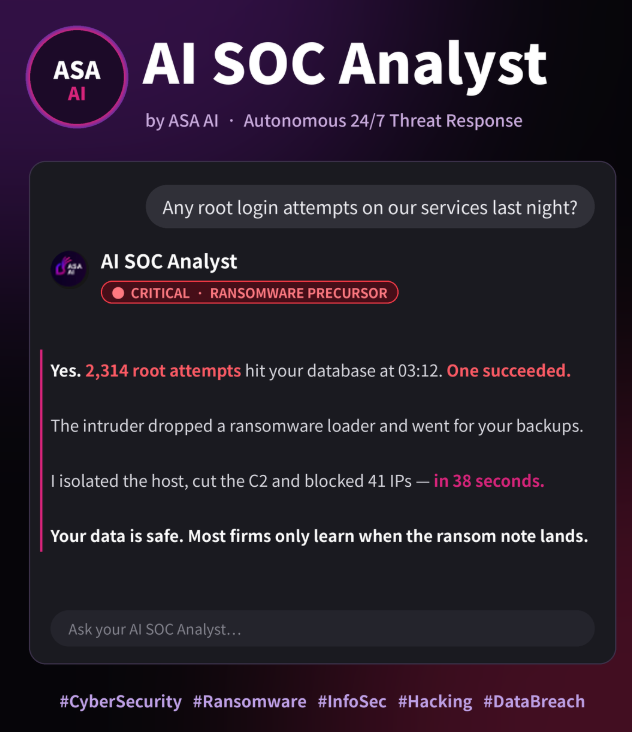
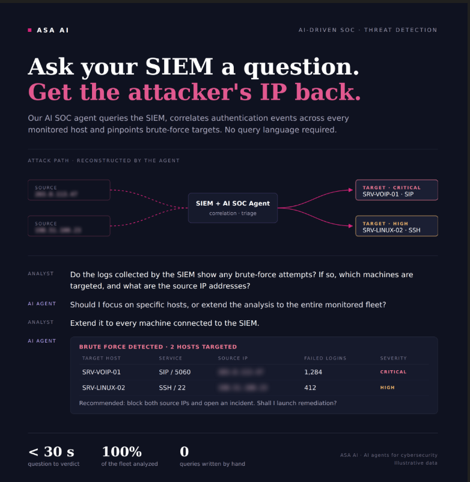
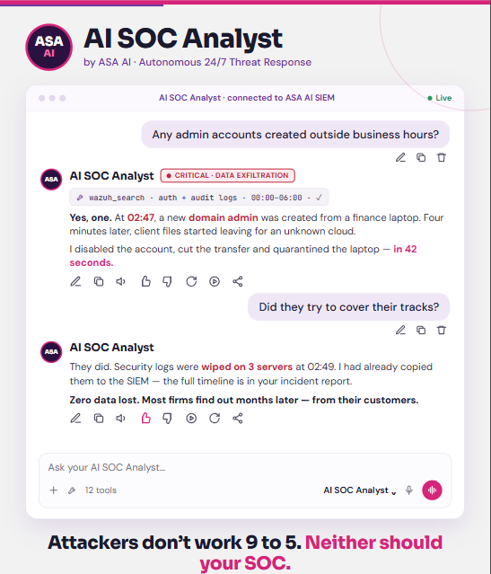


<a href="README.md">🌐 English</a> · <b>Français</b> · <a href="README.es.md">Español</a>

# 🧠 ASA-AI SOC Analyst

### SOC autonome piloté par l'IA — détecter, corréler et répondre en quelques secondes

**Posez une question à votre SIEM. Faites stopper l'attaquant.**

---

## Votre équipe ne peut pas tout surveiller, 24/7. Lui, si.

Fatigue des alertes, trous de couverture, triage lent. **ASA-AI SOC Analyst** est un agent autonome qui **interroge votre SIEM en langage naturel**, corrèle les alertes en véritables chaînes d'attaque, et exécute la **remédiation en quelques secondes** — avec un humain dans la boucle.

## En action

## Ce qu'il fait

- 🗣️ **Requêtes SIEM en langage naturel** — aucun langage de requête requis.
- 🔗 **Corrélation des alertes** en chaînes d'attaque réelles (mappées MITRE ATT&CK).
- ⚡ **Remédiation autonome** — isoler les hôtes, révoquer les sessions, bloquer les IP — validée par un humain.
- 📋 **Chronologie d'incident, IOC & preuves** livrés à vos analystes.

## Pour qui ?

- **Entreprises** avec une petite équipe sécurité.
- **MSSP / SOC** qui montent en charge sans recruter.
- **Équipes IT** qui ont besoin d'une réponse 24/7 qu'elles n'ont pas aujourd'hui.

---

## 🚀 Vous automatisez votre SOC ? Parlons-en.

### 📩 **contact@asa-ai.fr** · 🌐 **[asa-ai.fr](https://www.asa-ai.fr)**

---

## À propos d'ASA AI

**ASA AI** conçoit des solutions de **sécurité VoIP** et d'**automatisation du SOC** pilotées par l'IA.

🌐 [asa-ai.fr](https://www.asa-ai.fr) · 📩 [contact@asa-ai.fr](mailto:contact@asa-ai.fr) · 💼 [LinkedIn](https://www.linkedin.com/in/asa-ai-101815430/)

Captures à données illustratives · © ASA AI · Île-de-France, France
